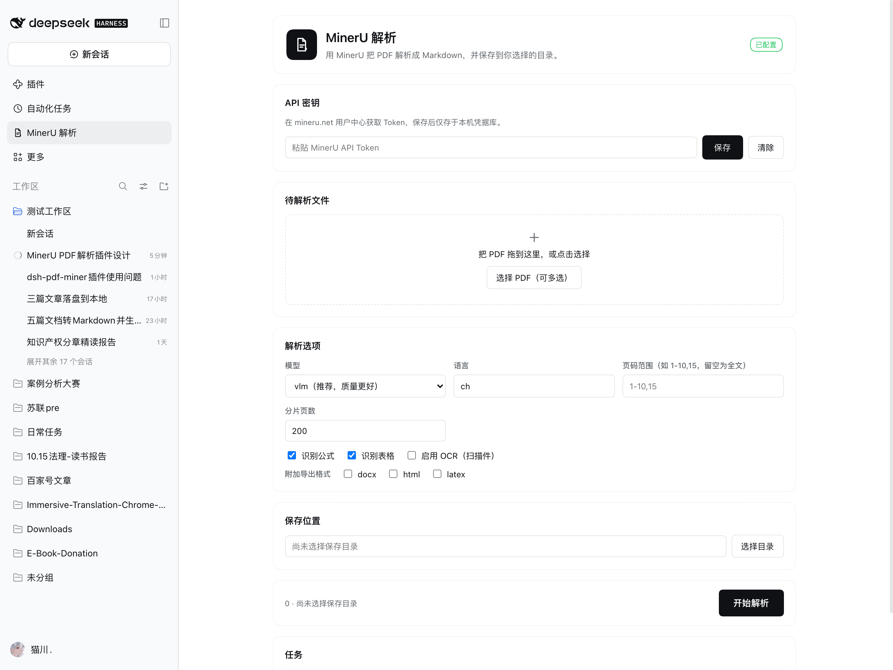
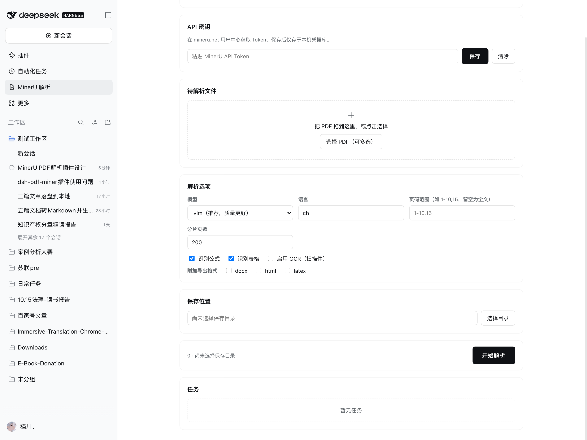

<p align="center">
  
</p>

<h1 align="center">MinerU PDF Parser Plugin for DeepSeek Harness</h1>

<p align="center">
  A full-featured <b>MinerU PDF parsing plugin</b> built for <b>DeepSeek Harness (DSH)</b>.<br>
  Integrates a dedicated left sidebar panel and an Agent Tool, supporting LaTeX formulas, complex tables, scanned PDF OCR, smart chunking for long documents, and resilient retries.
</p>

<p align="center">
  <a href="https://github.com/topics/dsh-plugin"></a>
  <a href="https://github.com/Mu-scorpio/dsh-mineru/releases"></a>
  <a href="LICENSE"></a>
  <a href="https://mineru.net"></a>
</p>

[中文文档](README.md) | English

---

## 📸 Screenshots

### Interactive Panel
> Resident in the DeepSeek Harness left navigation rail for one-click access.

<p align="center">
  
</p>

### Configuration & Task Tracking
> Model selection, chunking control, formula/table switches, and real-time task progress.

<p align="center">
  
</p>

---

## ✨ Features

- 🎯 **Dedicated Left Sidebar Entry**: Native panel inside DSH, keeping your workflow clean and uninterrupted.
- 🔬 **High-Fidelity Document Extraction**: Powered by OpenDataLab MinerU v4 API, extracting complex LaTeX formulas, multi-column tables, and image references into structured Markdown.
- ⚡ **Smart Chunking for Long PDFs**: Overcomes the upstream 200-page limit by automatically inspecting page counts, splitting requests into batches, and transparently concatenating Markdown & media assets locally.
- 📂 **Smart Folder Auto-Fill**: Automatically defaults the save folder to the directory of selected PDF files. Also supports native directory chooser dialogs.
- 🛡️ **Secure Credentials Management**: Stores API Tokens securely in Harness local credentials store (`~/.dsh/.credentials.yaml`). Tokens are masked in UI and never leaked to sessions.
- 🔄 **State Persistence & Retry**: Task states survive page reloads and panel switches, with granular error reporting and one-click retry.
- 🤖 **Agent Tool Included**: Registers `mineru_parse` so the AI assistant can parse PDFs on your behalf directly during conversation.

---

## 📦 Installation

### From DeepSeek Harness Plugin Market
Search for `dsh-mineru` in **Settings → Plugin Market** and click **Install**.

### From DSH CLI
```bash
# Direct GitHub install
dsh plugin add github:Mu-scorpio/dsh-mineru

# Or fast prebuilt tarball install
dsh plugin add https://github.com/Mu-scorpio/dsh-mineru/releases/download/v1.0.0/dsh-mineru-1.0.0.tgz
```

---

## 📄 License

Distributed under the [MIT License](LICENSE).
