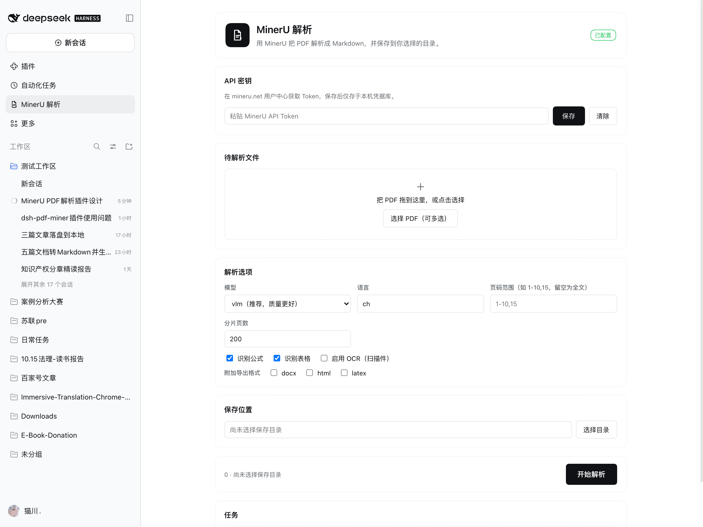
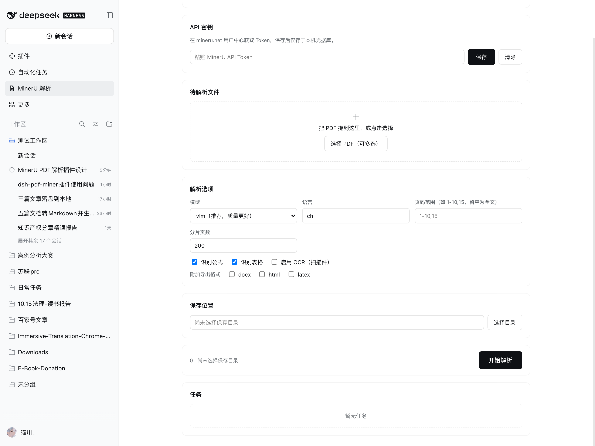

<p align="center">
  
</p>

<h1 align="center">MinerU PDF 解析插件 for DeepSeek Harness</h1>

<p align="center">
  适用于 <b>DeepSeek Harness (DSH)</b> 的全功能 <b>MinerU PDF 智能提取与解析插件</b>。<br>
  集成左侧交互面板与 Agent Tool，支持数学公式、复杂表格、扫描件 OCR 高保真解析为 Markdown，内置超长文档智能分片与断点重试。
</p>

<p align="center">
  <a href="https://github.com/topics/dsh-plugin"></a>
  <a href="https://github.com/Mu-scorpio/dsh-mineru/releases"></a>
  <a href="LICENSE"></a>
  <a href="https://mineru.net"></a>
</p>

---

## 📸 界面预览

### 插件交互面板
> 独立位于 DeepSeek Harness 左侧导航栏，随时一键调出。

<p align="center">
  
</p>

### 选项配置与任务追踪
> 支持模型选择、分片控制、公式/表格识别设置、保存目录一键提取与实时进度查看。

<p align="center">
  
</p>

---

## ✨ 核心特性

- 🎯 **左侧独立入口 & 原生面板**：在 DeepSeek Harness 左侧主导航区常驻 MinerU 品牌图标，独立页面操作，告别弹窗干扰。
- 🔬 **高保真复杂提取**：基于 OpenDataLab MinerU v4 接口，支持 LaTeX 数学公式识别、跨页多列复杂表格结构化还原、图表多模态抽取。
- ⚡ **超长 PDF 智能分片 (Smart Chunking)**：针对官方 API 的页数限制，自动感知 PDF 总页数；超过阈值（默认 200 页）自动分批次请求，并在解析完成后本地无缝拼接最终 Markdown 与图片资源。
- 📂 **智能目录联动**：
  - 选中 PDF 文件后，自动将保存目录预填为该文件所在目录，无需手动重复寻找。
  - 支持调用系统原生目录选择器，支持自定义任意保存路径。
- 🛡️ **安全凭据库管理**：API Token 仅保存在 DeepSeek Harness 本地凭据库（`~/.dsh/.credentials.yaml`），界面输入自动脱敏，不随会话上传，安全可靠。
- 🔄 **状态持久化与重试**：
  - 任务状态由 Host 引擎管理，切换页面、刷新界面不丢失任务。
  - 针对网络波动或接口异常提供精细错误码与「一键重试」。
- 🤖 **Agent 工具直接赋能**：同时注册了 `mineru_parse` 工具，在对话中可以让 DeepSeek 智能助手直接调用解析指定 PDF 并读取成果。

---

## 📦 安装方式

### 方式一：在 DeepSeek Harness 插件市场中安装（推荐）

在 DeepSeek Harness 中打开 **设置 → 插件市场 (Plugin Market)**，搜索 `dsh-mineru`，点击 **安装** 即可。

### 方式二：通过 DSH CLI 安装

```bash
# 从 GitHub 仓库直接添加
dsh plugin add github:Mu-scorpio/dsh-mineru

# 或从 Release 预打包文件免编译极速安装
dsh plugin add https://github.com/Mu-scorpio/dsh-mineru/releases/download/v1.0.0/dsh-mineru-1.0.0.tgz
```

### 方式三：本地开发安装

```bash
git clone https://github.com/Mu-scorpio/dsh-mineru.git
# 在 Harness 中使用 plugin_manager 或者通过符号链接进行调试
```

安装完成后，刷新应用（`Cmd + R` / `Ctrl + R`），左侧导航栏即刻出现 **MinerU 解析** 图标。

---

## 🚀 快速上手

1. **获取 API 密钥**：
   - 访问 [MinerU 官方开放平台](https://mineru.net/apiManage/docs) 注册并复制您的 API Token。
2. **配置密钥**：
   - 点击左侧 **MinerU 解析** 图标进入页面。
   - 在「API 密钥」栏粘贴 Token 并点击 **保存**（右上角状态将变为绿色的「已配置」）。
3. **开始解析**：
   - 将单个或多个 PDF 文件拖拽至上传区域，或点击「选择 PDF」。
   - 确认解析选项（模型、公式、表格、语言等，默认已针对中文论文与技术文档调优）。
   - 点击底部 **开始解析**，任务卡片将实时更新进度与状态。
4. **获取成果**：
   - 解析完成后，结果自动解压并归档至指定保存目录（包含 `full.md`、提取的图片目录以及可选的 docx/html 文件）。

---

## ⚙️ 解析选项说明

| 参数项 | 说明 | 推荐/默认值 |
|---|---|---|
| **模型版本** | `vlm` (多模态高精度模型，推荐) 或 `pipeline` | `vlm` |
| **文档语言** | 文档语种代码，如 `ch` (中/英混合)、`en` 等 | `ch` |
| **页码范围** | 抽取部分页码，例如 `1-10,15`；留空代表解析全文 | 留空（全文） |
| **分片页数** | 超过该页数的超长文档将触发自动切片与本地聚合 | `200` |
| **公式识别** | 开启后将行内与独立公式转为 LaTeX 语法 | 开启 (Checked) |
| **表格识别** | 开启后将各类表格转为标准 Markdown 表格 | 开启 (Checked) |
| **启用 OCR** | 适用于扫描件或纯图片版 PDF | 视文件类型开启 |
| **附加导出** | 可额外产出 `docx`、`html` 或 `latex` 文件 | 可选 |

---

## 🛠️ 架构与技术细节

- **Cordis 架构规范**：严格分离 Host 宿主生命周期与 Web Client 前端沙箱。
- **直连高速下载**：针对国内 CDN 与代理网络，下载解析结果 Zip 时优先采用直连传输与流式解压，避免 TLS 重置与超时。
- **原子化文件落盘**：多分片并发/串行处理完毕后，自动维护图片引用路径与 Markdown 结构合并。

---

## 📄 开源许可

本项目遵循 [MIT License](LICENSE) 开源协议。
欢迎提交 Issue 与 Pull Request 共同改进！
